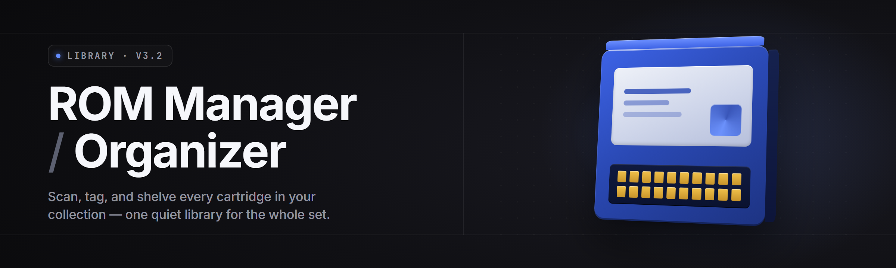

  
  
  

  

  
  

---

**rom-library-organizer** — the ROM manager / organizer for people with 40,000 files and zero patience. Built it over months on my main rig, still the tool I open first. `see FAQ for detection/updates`

---

## 📦 Overview

I built `rom-library-organizer` because every ROM manager I tried either wanted a cloud account, wanted my whole drive indexed into some proprietary `.db`, or choked the moment a folder had more than 8,000 files in it. This one doesn't. It's a Windows `.exe` — download, extract, run. No Python, no npm, no git clone, no runtime to install. It reads your ROM folders, hashes everything, matches against a local DAT, and rebuilds your library the way it should've been sorted in 2019.

| Category | Details |
| --- | --- |
| **What it is** | Desktop ROM manager / organizer for Windows |
| **Runs as** | Single portable `.exe` (no installer required) |
| **Core job** | Scan → hash → match DAT → rename → sort → dedupe |
| **Formats** | 41 console + handheld + arcade systems supported |
| **Data source** | Local No-Intro / Redump / MAME DAT files you already have |
| **Network** | Optional — offline-first by default |
| **Footprint** | ~14 MB binary, ~90 MB RAM idle on a 40k-file library |
| **Year** | 2026 release line, v2.x |

The goal was never to be the biggest. It was to be the one that doesn't lie to you about what your library actually contains. If a file is a bad dump, it says bad dump. If two files are the same game, it tells you which hash matches the DAT and which one is the hanger-on.

  

---

## 🧩 What is a ROM manager / organizer, really?

| Term | Explanation |
| --- | --- |
| **ROM** | A dump of a game cartridge, disc, or arcade board — one file, one game, sometimes many files in a set |
| **DAT** | A catalog (No-Intro, Redump, MAME) listing the exact name + hash every good dump should have |
| **Good dump** | A ROM whose CRC32/SHA-1 matches the DAT entry — verifiable, not "probably fine" |
| **Bad dump** | A ROM that loads but hashes wrong — often a bad rip, a hacked version, or a corrupted transfer |
| **Set** | All files belonging to one game (a `.cue` + `.bin` pair, a multi-disc `.m3u`, a MAME `.zip`) |
| **1G1R** | "1 Game 1 ROM" — one canonical copy per game, region-priority sorted |
| **Rebuild** | Extracting loose files from archives and re-packing them into DAT-correct sets |

The pitch in plain terms:

- 🗂️ One place that knows what every file in your library is, without you opening 200 folders.
- 🔎 Hash-based matching — not filename guessing, not "close enough."
- 🧹 Deduplication that keeps the correct copy and flags the rest instead of nuking both.
- 🏷️ Renaming to DAT-canonical names so every frontend (EmulationStation, LaunchBox, Pegasus) just works.
- 📴 Offline-first. Your library never leaves your machine unless you tell it to.

---

## 🎯 Key Features

| Feature | Description | Benefit |
| --- | --- | --- |
| **Hash scanner** | CRC32, MD5, SHA-1 in parallel across all cores | Verifies 40k files in minutes, not hours |
| **DAT matcher** | Loads No-Intro / Redump / MAME DATs, matches by hash first | No false positives from filename collisions |
| **Smart rename** | Renames to canonical DAT name, keeps your folder tree | Frontends stop showing "unknown game" |
| **Dedupe engine** | Finds identical hashes across folders, keeps the best copy | Reclaims real disk space without guesswork |
| **1G1R builder** | Region-priority rules, per-system overrides | One clean copy per game, no region spam |
| **Archive re-pack** | Reads `.zip`/`.7z`/`.rar`, rebuilds to DAT-correct sets | Fixes "wrong files in the zip" without manual work |
| **M3U generator** | Auto-builds multi-disc playlists for PS1, Saturn, Dreamcast | Multi-disc games launch as one entry |
| **BIOS checker** | Verifies required BIOS files per system by hash | Emulators stop booting to a black screen |
| **Missing report** | Lists every DAT entry you don't have, per system | You know exactly what to hunt next |
| **Duplicate report** | CSV export of every duplicate group with hash + path | Auditable, scriptable, diffable |
| **Preset profiles** | Save scan rules per collection (arcade vs. handheld) | One click to switch workflows |
| **Dry-run mode** | Shows every action before touching a file | Nothing moves until you say so |

---

## 😤 The Problem

- Every ROM manager I tried wanted to **upload my file list somewhere** before it would sort anything.
- **Filename matching** breaks the moment a set has a scene tag, a `[!]`, or a bad-rip suffix — everything gets mislabeled.
- **Dedupe tools nuke both copies** when they can't decide which is correct, and you find out three weeks later.
- Multi-disc games end up as **five separate entries** in every frontend, because nobody writes the `.m3u`.
- BIOS files go missing silently, and the emulator just **boots to a black screen** with no error.
- A **40,000-file library** turns most tools into a spinner that never finishes, or an out-of-memory crash at 60%.
- Renaming breaks **your existing folder structure**, so half your frontend paths go dead overnight.

---

## ✅ The Solution

| Problem | Solution |
| --- | --- |
| Cloud upload required | Offline-first — nothing leaves your machine unless you enable sync |
| Filename matching | Hash-first matching (CRC32/MD5/SHA-1) against your local DAT |
| Dedupe nukes both copies | Keeps the DAT-verified copy, flags the rest in a report |
| Multi-disc sprawl | Auto `.m3u` generation + grouped set view |
| Silent BIOS failures | Per-system BIOS hash check with a clear missing-file report |
| Spinner-that-never-finishes | Parallel scanner, streaming hash pipeline, bounded memory |
| Rename breaks folder tree | In-place rename mode keeps your directory layout intact |

---

## 🗺️ Grouped module catalog

### 🎮 Console & handheld systems

- **Nintendo set** — NES, SNES, N64, Game Boy, GBA, DS, 3DS
- **Sega set** — Master System, Genesis, Saturn, Dreamcast, Game Gear
- **Sony set** — PS1, PS2, PSP
- **Microsoft set** — Xbox, Xbox 360 (disc-image aware)
- **Atari + retro set** — 2600, 5200, 7800, Lynx, Jaguar

### 🕹️ Arcade & set-based systems

- **MAME set** — full set verification, split/merged/non-merged modes
- **FinalBurn set** — CPS1/CPS2/CPS3/NEO-GEO specific handling
- **Neo Geo set** — BIOS-aware, per-game BIOS variants
- **Sega Model set** — Model 2 / Model 3 disc + rom handling

### 🧮 Hashing & verification

- **CRC32 engine** — fast-pass for large archives, skips already-hashed files
- **MD5 engine** — legacy DAT compatibility
- **SHA-1 engine** — modern No-Intro / Redump standard
- **Hash cache** — persisted per-file, invalidated on mtime change
- **Sample verification** — spot-checks a subset when you don't want a full pass

### 🗃️ Library management

- **Dedupe engine** — cross-folder duplicate detection with keep rules
- **1G1R builder** — region priority, per-system overrides, exclusion lists
- **Missing report** — per-system gap list against the loaded DAT
- **Rename engine** — DAT-canonical renaming with in-place or move mode
- **Folder templates** — `{system}/{letter}/{game}` and custom patterns
- **Archive re-pack** — rebuild sets from loose files, DAT-correct output

### 🧰 Emulator & frontend glue

- **EmulationStation exporter** — `gamelist.xml` generation with metadata
- **LaunchBox importer** — path-mapped import for existing LaunchBox users
- **Pegasus exporter** — `.metadata.pegasus.txt` per system
- **M3U generator** — multi-disc playlists, auto-named
- **BIOS checker** — per-system required-file hash verification
- **Cover art matcher** — optional, local-folder based, no scraping by default

### ⚙️ Core & workflow

- **Scanner core** — parallel directory walk, bounded memory pipeline
- **Profile system** — save scan/rename rules per collection
- **Dry-run engine** — every action previewed before execution
- **Action log** — JSONL log of every file operation, replayable
- **CLI mode** — headless runs for scheduled tasks
- **Config sync** — export/import profiles as a single file

---

## 📊 All modules status

| Module | Status | Description |
| --- | --- | --- |
| Scanner core | ✅ Working | Parallel walk, bounded memory |
| CRC32 engine | ✅ Working | Fast-pass hashing |
| MD5 engine | ✅ Working | Legacy DAT support |
| SHA-1 engine | ✅ Working | Modern DAT standard |
| Hash cache | ✅ Working | Per-file, mtime-invalidated |
| DAT matcher | ✅ Working | No-Intro / Redump / MAME |
| Dedupe engine | ✅ Working | Keep-rules + report |
| 1G1R builder | ✅ Working | Region priority rules |
| Rename engine | ✅ Working | In-place or move mode |
| Archive re-pack | ✅ Working | zip / 7z / rar read |
| M3U generator | ✅ Working | Multi-disc playlists |
| BIOS checker | ✅ Working | Per-system hash verify |
| EmulationStation exporter | ✅ Working | gamelist.xml |
| LaunchBox importer | ✅ Working | Path-mapped import |
| Pegasus exporter | ✅ Working | metadata.pegasus.txt |
| CLI mode | ✅ Working | Headless runs |
| Profile system | ✅ Working | Per-collection rules |
| Dry-run engine | ✅ Working | Preview before execute |
| Action log | ✅ Working | JSONL, replayable |
| Cover art matcher | 🟡 Beta | Local-folder only |
| MAME set verifier | ✅ Working | split / merged / non-merged |
| Neo Geo BIOS handling | ✅ Working | Per-game BIOS variants |
| Xbox 360 disc-image aware | 🟡 Beta | Disc-image indexing |
| Config sync | ✅ Working | Single-file export/import |
| Sample verification | ✅ Working | Subset spot-checks |
| Missing report | ✅ Working | Per-system gap list |
| Folder templates | ✅ Working | Custom patterns |
| Region priority rules | ✅ Working | Per-system overrides |
| Exclusion lists | ✅ Working | Skip-by-pattern |
| Path-mapping rules | ✅ Working | LaunchBox + Pegasus |
| Metadata passthrough | ✅ Working | Preserves existing XML |
| Multi-disc grouping | ✅ Working | Set-aware view |
| Bad-dump flagging | ✅ Working | Hash mismatch report |
| Scene-tag parsing | ✅ Working | `[!]`, `(Rev 1)`, etc. |
| Hanger-on detection | ✅ Working | Extra files in archives |
| Compression pass | ✅ Working | Optional re-pack to zip |
| CSV export | ✅ Working | Duplicate + missing reports |
| JSONL action log | ✅ Working | Replayable |
| Scheduled runs | ✅ Working | Windows Task Scheduler |
| Portable config | ✅ Working | Single-file profiles |
| Auto-update check | ✅ Working | Opt-in, silent by default |

---

## 🧠 Tips for best results

- Run a **dry-run first** on your biggest system — you'll see exactly what would move before anything does.
- Point the scanner at **one system folder at a time** on the first pass; the hash cache makes the second pass near-instant.
- Keep your **DAT files in a dedicated folder** and load them once — re-parsing is the slow part, matching is fast.
- Enable **in-place rename** if your frontend already points at your current folder tree.
- Let **BIOS checker** run before you debug a black-screen emulator — it's the cause 80% of the time.
- Don't enable **archive re-pack** on a library you haven't backed up. It rewrites files; that's the point.
- Use **profiles** if you have both an arcade set and a handheld set — the rules are genuinely different.
- The **action log** is JSONL for a reason. Diff it between runs when something looks off.

---

## 🖥️ Compatibility / platform support

| Platform | Support level | Notes |
| --- | --- | --- |
| Windows 11 (x64) | Full | Primary target |
| Windows 10 (x64) | Full | 21H2+ |
| Windows Server 2019+ | Partial | CLI mode only, GUI untested |
| Windows on ARM | Partial | Runs under x64 emulation |
| Linux (Wine) | Experimental | Not officially supported |
| macOS | Not supported | No current plan |

---

## 🧮 System Requirements

| Component | Minimum | Recommended |
| --- | --- | --- |
| OS | Windows 10 x64 | Windows 11 x64 |
| CPU | Dual-core 2.0 GHz | Quad-core 3.0 GHz+ |
| RAM | 4 GB | 16 GB |
| Storage | 500 MB for app + cache | SSD for library + cache |
| Disk I/O | HDD acceptable | NVMe SSD strongly preferred |
| Network | Not required | Optional for update check |
| GPU | None required | Any (GUI only) |

---

## 🚀 Quick Start

1. 📄 Head to the project page and grab the release.
2. 🗜️ Extract the archive to a folder you control — **not** inside your ROM library.
3. ▶️ Run the `.exe`. No install, no dependencies, no runtime.
4. 📁 Point it at one system folder and load your DAT.
5. ✅ Dry-run, review, then execute.

---

## 📥 Installation

1. **Download the release archive** from the landing page. It contains the `.exe`, a default config, and a short README.
2. **Extract** anywhere on a drive with write access — a folder on the same disk as your library keeps moves fast.
3. **Run the `.exe`.** First launch creates a config folder next to the binary. Everything is portable; nothing writes to `AppData` unless you enable sync.

---

## 🧾 Usage guidelines

| Allowed | Not allowed |
| --- | --- |
| Managing **your own** dumped or purchased ROMs | Distributing ROMs you don't own |
| Verifying dumps against public DATs | Re-uploading DAT-matched sets elsewhere |
| Organizing arcade + console libraries | Using the tool to bypass DRM on modern titles |
| Automating your own local workflow | Running it against a network share you don't own |
| Exporting metadata for your frontend | Bundling the `.exe` into a paid product |

---

## 🧯 Known Issues

| Issue | Fix |
| --- | --- |
| First scan on a 100k+ library can take a while | Let the hash cache warm up; second pass is near-instant |
| `.rar` sets with solid compression read slower | Re-pack to `.zip` or `.7z` for faster future scans |
| MAME merged-set mode needs the full parent set | Load the parent + child DATs together |
| Cover art matcher misses non-standard filenames | Use folder-per-game naming or enable fuzzy match |
| Xbox 360 disc-image indexing is Beta | Report mismatches via the action log |
| Windows Defender may flag the `.exe` on first run | It's a signed portable binary; add an exclusion if needed |

---

## 🧭 Comparison

| Aspect | Alternative | This Tool |
| --- | --- | --- |
| Matching method | Filename-first | Hash-first |
| Network requirement | Often cloud-based | Offline-first |
| Dedupe behavior | Deletes both on ambiguity | Keeps verified copy, flags rest |
| Multi-disc support | Manual `.m3u` | Auto-generated |
| BIOS handling | Silent failure | Hash-verified check |
| Frontend integration | One target, if any | ES / LaunchBox / Pegasus |
| Library size ceiling | Chokes past ~10k files | Designed for 100k+ |
| Reversibility | Often destructive | Dry-run + JSONL action log |

---

## 🛠️ FAQ

| Question | Answer |
| --- | --- |
| **Is it safe to run?** | Yes — it's a signed portable `.exe`, no installer, no background service. Every file operation is logged. |
| **Does it work on Steam / Steam Deck?** | Not natively. It targets Windows x64. Steam Deck users run it under Wine at their own risk. |
| **Does it phone home?** | No. Offline-first. The only network call is an opt-in update check you can disable. |
| **Do I need a cloud account?** | No. There is no account system. |
| **Where do I get DAT files?** | From No-Intro, Redump, and MAME project releases — this tool reads them, it doesn't ship them. |
| **Will it rename my files without asking?** | Only in execute mode. Dry-run is the default on first launch. |
| **Does it delete duplicates automatically?** | No. It flags them in a report. You decide. |
| **Can I run it headless?** | Yes — CLI mode for scheduled tasks. |
| **How does detection work?** | It doesn't "detect" anything external; it verifies your files against DAT hashes. That's the whole check. |
| **How often is it updated?** | Roughly monthly point releases, with a changelog on the project page. |

---

## 🔧 Hotkeys

| Key | Action |
| --- | --- |
| `Ctrl+O` | Open folder |
| `Ctrl+D` | Load DAT |
| `Ctrl+R` | Run scan (dry-run) |
| `Ctrl+Shift+R` | Run scan (execute) |
| `Ctrl+E` | Export report |
| `F5` | Refresh library view |
| `Esc` | Cancel current operation |

---

## 🧷 Notes on updates & detection

The update check is opt-in and off by default. When enabled, it fetches a small version manifest — nothing else. There is no telemetry, no analytics, and no library data ever leaves your machine. If you're running in an air-gapped setup, disable the check entirely in config and the tool never opens a socket.

---

## 📦 Final download

If your library is a mess and you've given up on tools that want your data before they'll sort your files, this is the one to try. It's portable, it's offline, and it tells you the truth about what you actually have. Back up before you execute, dry-run before you commit, and read the action log when something surprises you.

  

